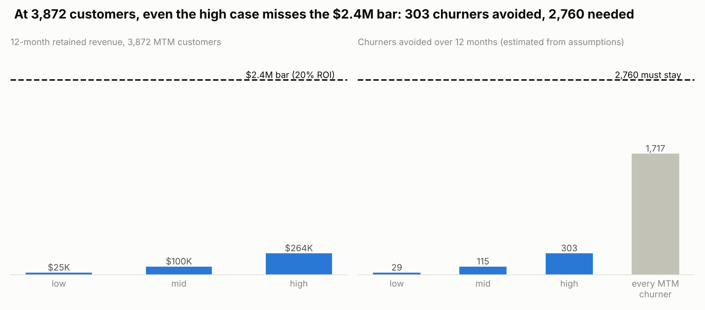
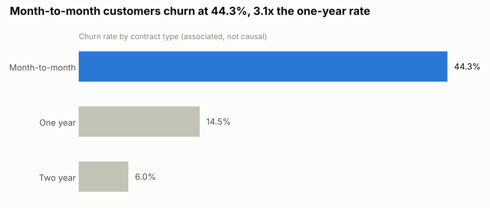
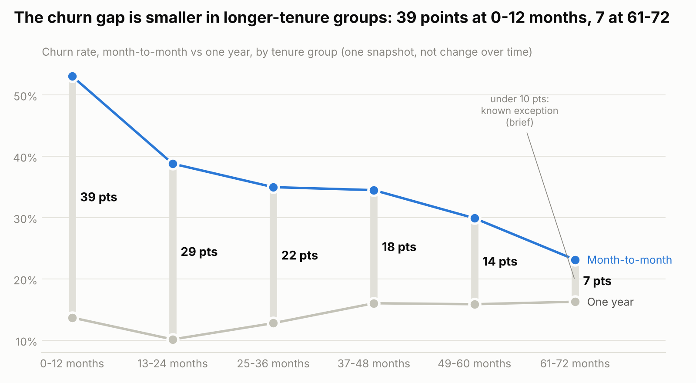
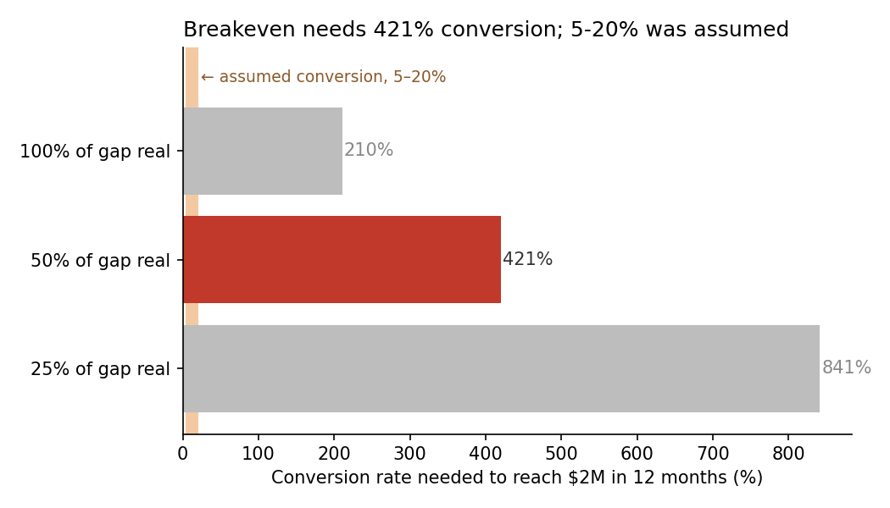

# Should we fund the $2M campaign?

**Question:** Should we spend $2M to move month-to-month customers to 1-year contracts?

## Answer: No, do not fund at the base we can see

Three analyses, each run against its own brief, reach the same answer. The data has **about 3,870 month-to-month customers**. Even in the most generous case each analysis allows (every month-to-month churner stays in v1 and v3, $1.49M; everyone converts and the whole gap is real in v2, $951K), 12-month revenue kept is below the $2M cost. The only thing that could change the answer is the real size of the month-to-month base: it would have to be roughly **8–100× larger** than this file.

## The three recommendations

| | v1: break-even | v2: break-even, by conversion | v3: 20% ROI |
|---|---|---|---|
| Brief | [`2m-campaign.md`](briefs/2m-campaign.md) | [`2m-campaign-v2.md`](briefs/2m-campaign-v2.md) | [`2m-campaign-v3.md`](briefs/2m-campaign-v3.md) |
| Decides | VP of Marketing | Ashwin | VP of Marketing |
| Bar (12-month retained revenue) | ≥ $2M | ≥ $2M | **≥ $2.4M** |
| Duplicate rows kept | Churn = Yes | Churn = No | Churn = Yes |
| ×100 monthly charges | Fixed (÷100) | Left out of averages | Fixed (÷100) |
| Headline | High case keeps **$264K**; **2,299** churners must stay | **421%** of month-to-month customers would have to convert (vs 5–20% assumed) | High case keeps **$264K** (ROI −87%); **2,759** churners must stay |
| Base needed to clear the bar | 29,377 (high) / 77,114 (mid) / 308,457 (low) | about 130,421 (mid) | 35,252 (high) / 92,537 (mid) / 370,149 (low) |
| Recommendation | `do_not_fund` | `do_not_fund` | `do_not_fund` |
| Write-up | [recommendation.md](runs/2m-campaign/recommendation.md) | [recommendation.md](runs/2m-campaign-v2/recommendation.md) | [recommendation.md](runs/2m-campaign-v3/recommendation.md) |

**If the real base is larger** (v3 rule): below 35,252 month-to-month customers, do not fund; 35,252–370,149, run a pilot first (offer the 1-year contract to 4,321 customers and hold out 4,321); above 370,149, fund.

## What the data shows

Month-to-month customers churn about **3× as often** as 1-year customers (44.3% vs 14.5% in v3's cleaned data):

The gap is **associated with** tenure: it is widest for new customers and narrows for long-tenure ones. Half of month-to-month customers are in their first year, so weighted by their tenure mix the gap stays about 31 points. The data cannot tell how much of the gap a contract switch would actually remove; every analysis treats that share as an assumption.

v2 asks the question as a conversion rate: break-even needs far more than 100% of month-to-month customers to convert under any cleaning choice tested.

## Data issues (handled in every analysis, logged in each `cleaning_log.md`)
- 211 customer IDs appear twice, each pair disagreeing on `Churn`. Each analysis picks one row per its brief and reruns with the other; the answer does not change.
- 200 `MonthlyCharges` values look ×100 (max 11,515).
- 11 blank `TotalCharges` (new customers) set to 0.
- `RetentionOfferAccepted` is filled only for churners, so it leaks the answer; it is never used.
- Loyalty app users churn more overall but less within every contract type; the reversal lines up with contract mix (most users are month-to-month).

## Reviews
- **v2:** independent review rated it *ready to send*: [runs/telco/review.md](runs/telco/review.md).
- **v3:** independent review rated it *fix before sending*: [runs/telco/review-v3.md](runs/telco/review-v3.md). Every number reproduces; the headline wording and the rounding of two break-even thresholds need fixing. Not yet fixed.
- **v1:** reviewed as *fix before sending*; the fixes were made but not re-reviewed. That review was later replaced by v2's at the same path and is in git history (commit `7082ed7`).

Every number comes from each folder's `analysis.py`, which reruns from the raw data. Findings are associations from observational data, not causes.

**Data source:** IBM Telco Customer Churn sample data (a fictional company), modified for teaching. File: `data/raw/telco_v2.csv`.
